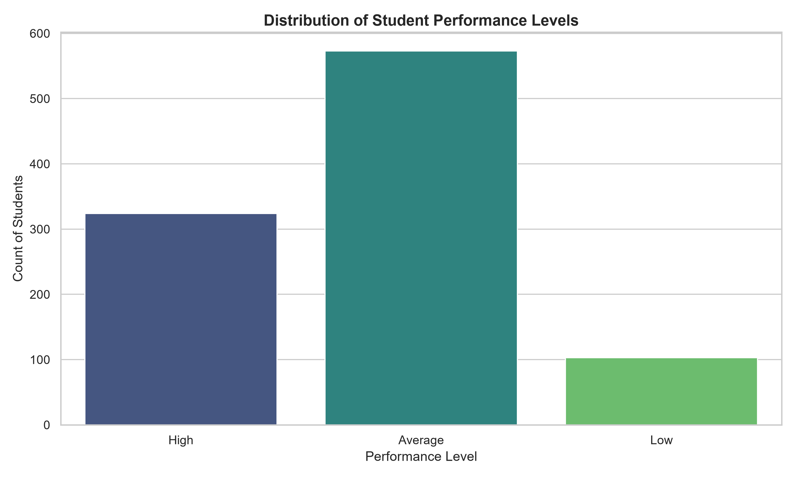
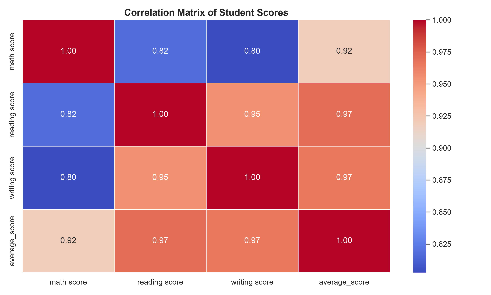
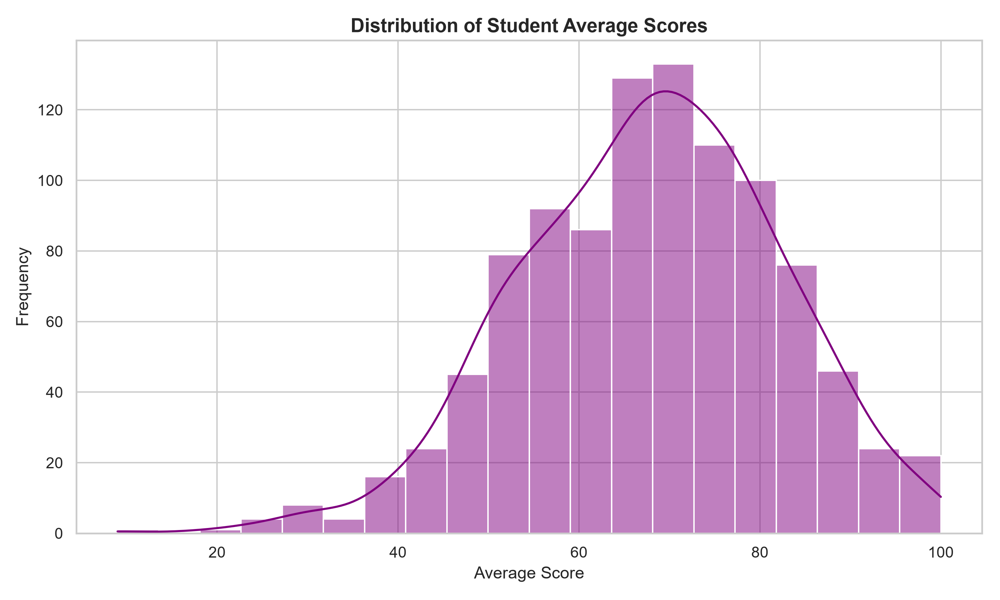
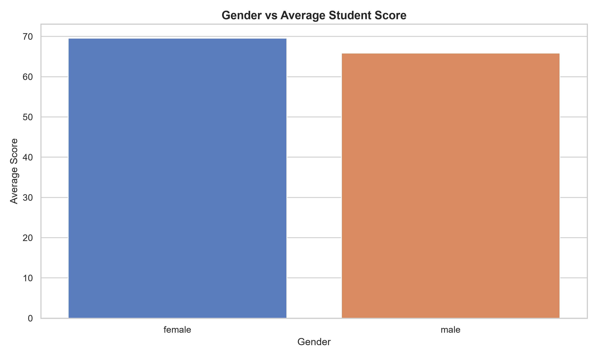

# 🎓 Student Performance Prediction & Recommendation System

[](https://www.python.org/)
[](https://streamlit.io/)
[](https://scikit-learn.org/)
[](https://pandas.pydata.org/)
[]()

An end-to-end Machine Learning web application that analyzes student demographic factors and academic exam scores, predicts their performance level (**High**, **Average**, or **Low**) with **97.00% accuracy**, and delivers targeted, actionable academic recommendations through an intuitive **Streamlit** dashboard.

---

## 🌟 Key Features

- **Exploratory Data Analysis (EDA):** Automated generation of statistical charts (distribution countplots, score correlation heatmaps, histograms, demographic analysis).
- **Machine Learning Pipeline:** Data preprocessing, missing value handling, label encoding, and model persistence using Python's `pickle`.
- **Random Forest Classifier:** Trained ensemble model delivering **97.00% classification accuracy**.
- **Interactive Web App:** Clean, modern user interface built with **Streamlit** featuring real-time input sliders and select boxes.
- **Smart Recommendation Engine:** Diagnostic feedback evaluating individual subject margins (Maths, Reading, Writing) to provide tailored study guidance.

---

## 📊 Exploratory Data Analysis (EDA) Previews

The training pipeline automatically produces high-resolution visualizations stored in the `screenshots/` directory:

| Performance Distribution | Correlation Heatmap |
| :---: | :---: |
|  |  |

| Score Distribution Histogram | Gender vs. Average Score |
| :---: | :---: |
|  |  |

---

## 📁 Project Directory Structure

```text
student-performance-prediction-system/
│
├── dataset/
│   └── StudentsPerformance.csv             # Kaggle benchmark student records (1,000 rows)
│
├── models/
│   ├── student_rf_model.pkl                # Trained RandomForestClassifier pickle model
│   └── label_encoders.pkl                  # Fitted Scikit-Learn LabelEncoders dictionary
│
├── screenshots/
│   ├── performance_levels_distribution.png  # Performance tier distribution graph
│   ├── average_scores_histogram.png        # Examination score histogram with KDE
│   ├── scores_correlation_heatmap.png       # Correlation matrix heatmap of subjects
│   └── gender_vs_average_score.png         # Gender vs performance comparison bar plot
│
├── main.py                                 # Pipeline script: EDA, preprocessing, training & saving
├── app.py                                  # Streamlit interactive web dashboard
├── requirements.txt                        # Python dependencies
└── README.md                               # Project documentation
```

---

## 🛠️ Installation & Setup Guide

### 1. Clone the Repository
```bash
git clone https://github.com/architchaurasiya/student-performance-prediction-system.git
cd student-performance-prediction-system
```

### 2. (Optional) Create and Activate a Virtual Environment
```powershell
# Windows
python -m venv .venv
.venv\Scripts\activate
```

### 3. Install Dependencies
```powershell
pip install -r requirements.txt
```

### 4. Train the Model & Generate EDA Charts
Execute `main.py` to process the dataset, generate visualizations, and train the Random Forest model:
```powershell
python main.py
```
> **Output:**
> - Evaluates missing and duplicate entries.
> - Computes average test score and performance tiers.
> - Saves 4 visual plots to `screenshots/`.
> - Saves `student_rf_model.pkl` and `label_encoders.pkl` inside `models/`.

### 5. Launch the Web Dashboard
Start the interactive Streamlit application:
```powershell
streamlit run app.py
```
Open your browser at **http://localhost:8501** to use the application!

---

## 🧠 Machine Learning Details

### 1. The Dataset
The Kaggle `StudentsPerformance.csv` dataset contains 1,000 student records with 8 core attributes:
- **Demographics:** `gender`, `race/ethnicity`, `parental level of education`, `lunch`, `test preparation course`.
- **Exam Scores:** `math score`, `reading score`, `writing score` (Scale: 0 to 100).

### 2. Feature Engineering & Target Metric
The performance tiers are derived from the composite average exam score:
$$\text{Average Score} = \frac{\text{Math Score} + \text{Reading Score} + \text{Writing Score}}{3}$$

- 🥇 **High:** Average score $\ge 75$
- 🥈 **Average:** Average score $\ge 50$ and $< 75$
- 🥉 **Low:** Average score $< 50$

### 3. Model Performance & Evaluation
- **Algorithm:** `RandomForestClassifier(n_estimators=100, random_state=42)`
- **Train/Test Split:** 80% Training (800 rows), 20% Testing (200 rows)
- **Evaluation Accuracy:** **97.00%** (194/200 test samples correctly classified)

```text
              precision    recall  f1-score   support

     Average       0.96      0.99      0.97       109
        High       0.98      0.95      0.97        64
         Low       1.00      0.93      0.96        27

    accuracy                           0.97       200
```

---

## 💡 Recommendation Engine Rules

The system diagnoses individual score deficits and triggers specific academic guidance:

| Trigger Condition | Actionable Recommendation |
| :--- | :--- |
| **Math Score $< 50$** | Focus more on Mathematics: practice formulas and problem-solving daily. |
| **Reading Score $< 50$** | Improve reading habits: read comprehension passages and editorials. |
| **Writing Score $< 50$** | Practice writing regularly: focus on essay drafting and grammar. |
| **Test Prep Course = 'none'** | Complete test preparation course: take practice mock exams. |
| **Average Score $< 50$** | Increase study hours: establish a structured daily study calendar. |

---

## 💻 Tech Stack

- **Language:** Python 3.11+
- **Machine Learning:** Scikit-Learn (Random Forest, LabelEncoder)
- **Data Manipulation:** Pandas, NumPy
- **Data Visualization:** Matplotlib, Seaborn
- **Web Interface:** Streamlit

---

## 👤 Author

**Archit Chaurasiya**
- GitHub: [@architchaurasiya](https://github.com/architchaurasiya)

---

## 📄 License
This project is open-source and available under the [MIT License](LICENSE).
